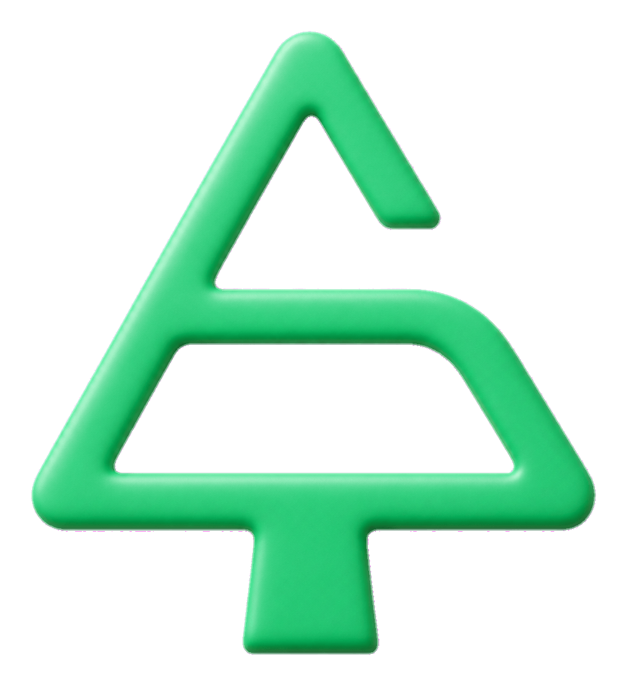
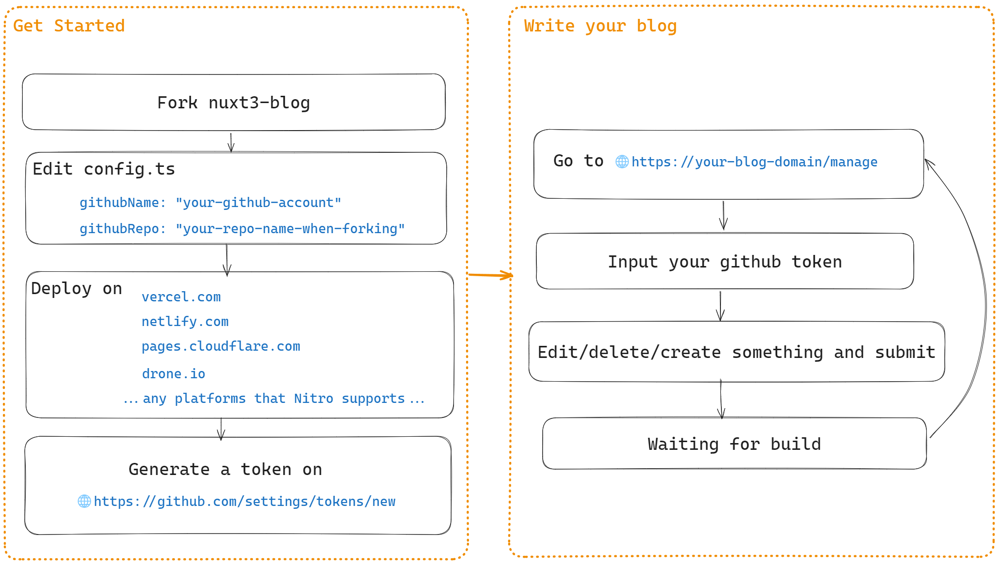

<p align="center">

</p>
<h1 align="center">💎Nuxt3-Blog</h1>

[](/LICENSE)   [](https://www.npmjs.com/package/@yunyuyuan/nuxt-blog)

English Readme | [中文说明](/README.md)

**🚀Deployed on multiple platforms via [NitroJS](https://nitro.unjs.io/) (the [official engine](https://nuxt.com/docs/guide/concepts/server-engine) for Nuxt3)**

> Vercel: [https://blog.yunyuyuan.net](https://blog.yunyuyuan.net)
>
> Cloudflare Page: [https://blog-cfpage.yunyuyuan.net](https://blog-cfpage.yunyuyuan.net)
>
> Netlify: [https://blog-netlify.yunyuyuan.net](https://blog-netlify.yunyuyuan.net)
>
> Github Pages:[https://blog-ghpage.yunyuyuan.net](https://blog-ghpage.yunyuyuan.net)
>
> **🚀Self-hosted deployment (refer to [my article](https://blog.yunyuyuan.net/articles/8346))**
> forgejo-runner: [https://blog-local-cf.yunyuyuan.net](https://blog-local-cf.yunyuyuan.net), where `cf` means using Cloudflare for intranet penetration

# Blog Features

- 💻 **5-minute setup**. Quick deployment without writing a single line of code.
- 🤝 **Easy to use**. Powerful admin interface that requires just one token to **update configurations, add/modify/delete blog content via web interface**, no need for `notepad` or `git push`.
- 🌐 **Pure static**. Packaged as a pure static website, no backend required.
- 🔍 **SEO friendly**. Every HTML page is pre-rendered, making it indexable by search engines.
  🔌 **Extensibility**. Provides multiple optional extension features, such as integration with Cloudflare R2 image storage, display of real-time page views, giscus comment system, and site-wide search.
- 🔒 **Encryption support**. Ability to encrypt any individual **article/record/culture** entry, or encrypt specific content sections that can only be viewed with a password.

# Setup Guide

## For detailed setup tutorial, please refer to the [wiki](https://github.com/yunyuyuan/nuxt3-blog/wiki)

There are two ways to set up a blog:

| Way | Use it when | Upgrade |
| --- | --- | --- |
| Starter template (recommended for new users) | You change only the configuration and the content | `pnpm add @yunyuyuan/nuxt-blog@^<major version>` |
| Fork this repository | You change the framework code | Click "Sync fork" on GitHub |

**Starter template**: the framework is installed as the npm package `@yunyuyuan/nuxt-blog`. Your repository contains only `config.ts`, your content and the deployment configuration. See [starter/README.md](/starter/README.md).

```bash
npx giget@latest "gh:yunyuyuan/nuxt3-blog/starter#master" my-blog
```

**Fork**: the framework code is in `layer/`, and the files of the site are in the root directory. If you change only the files in the root directory, syncing with upstream causes far fewer conflicts.

Blog principle example:

<center>

</center>

# To-Do List

#### Features

- [x] 404 page
- [x] Update data in local `npm run dev` environment
- [x] Automated testing
- [x] Static Site Generation (SSG)
- [ ] Plugin system
- [x] Support for serverless function image uploads
- [x] Database integration (page view statistics)
- [x] Algolia site-wide search
- [x] Blog image backup and migration
- [x] Password modification (currently only supports modification via npm scripts locally)

#### Appearance

- [x] Dark mode
- [x] Internationalization
- [ ] Multiple layout themes (lacking UI design)
- [x] Custom theme colors

##### Low Priority Features

- [ ] Different passwords for different encrypted pages
- [ ] Monaco editor support for additional markdown syntax highlighting
- [x] One-click pull updates from upstream GitHub repository
- [ ] IV for AES encryption
- [x] Block-level encryption
- [x] SSR for self-hosting ([reference](https://blog.yunyuyuan.net/articles/8346))
- [x] Support for Cloudflare Pages, Netlify, and other services

# Project Structure

- `/layer` Framework code, published as the npm package `@yunyuyuan/nuxt-blog`
  - `/app` Nuxt app: pages, components, composables, plugins and utilities
  - `/server` API server (image upload, page view statistics, etc.)
  - `/modules/blog.ts` Build-time logic: reads the site configuration and the content, generates the indexes, defines global constants
  - `/i18n` Internationalization translation files
  - `/scripts` Local scripts (`pnpm local:*`), executed by Gulp
  - `/vite-plugins` In development mode, writes commits from the admin pages to the local files
  - `/public/sticker` All emoji images
- `/starter` Template for new sites, depends on the npm package `@yunyuyuan/nuxt-blog`
- `/scripts/release.mjs` Release script for the maintainer (`pnpm release`), see [docs/release.md](./docs/release.md)
- `/config.ts` Blog configuration, must be modified
- `/public`
  - `/rebuild` All blog data. `articles/`, `records/` and `knowledges/` contain one md file for each item, with the metadata in YAML frontmatter at the start of the file. The build generates the indexes in `json/`; they are not committed
  - `/e2e/rebuild` Mock data for E2E testing
- `/e2e` E2E testing
- `/nuxt.config.ts` `extends: ["@yunyuyuan/nuxt-blog"]`, which uses `layer/` of this repository through the pnpm workspace

# Node Scripts

```json5
"scripts": {
  "build": "nuxt build", // Compile for SSR
  "dev": "nuxt dev", // Development
  "dev-for-test": "cross-env PORT=13000 VITESTING=\"true\" nuxt dev", // For E2E testing
  "build-for-test": "cross-env VITESTING=\"true\" nuxt build", // For E2E testing
  "prod-for-test": "cross-env PORT=13000 node .output/server/index.mjs", // For E2E testing
  "generate": "nuxt generate", // Deprecated
  "local:change-pwd": "gulp change-passwd", // Global password modification
  "local:generate-file-map": "gulp generate-file-map", // Collect all site files, output to file-map.json
  "local:download-file": "gulp download-file", // Read file-map.json, download all files to files/
  "local:substitute-file": "gulp substitute-file", // Read file-map.json, replace with new files (before running this script, modify newUrl in file-map.json to the URL to be replaced)
  "local:upload-algolia": "gulp upload-algolia", // Upload index data to Algolia
  "local:migrate-content": "gulp migrate-content", // Convert content in the old format (JSON index + md) to the frontmatter format, see docs/upgrade-v9.md
  "release": "node scripts/release.mjs", // Publish the npm package (maintainers), see docs/release.md
  "test:unit": "vitest run --exclude ./e2e", // Unit testing
  "test:e2e": "vitest run --dir ./e2e", // E2E testing
  "test:dev-and-e2e": "start-server-and-test dev-for-test http://localhost:13000 test:e2e", // Run test service and start E2E testing
  "test:prod-and-e2e": "start-server-and-test prod-for-test http://localhost:13000 test:e2e", // Run test prod and start E2E testing
  "eslint": "eslint --fix .", // Run eslint
  "typecheck": "nuxi typecheck", // Type checking
  "preview": "nuxt preview", // Preview compiled website
  "prepare": "husky" // Install husky
}
```

# Upgrade from v8 to v9

v9 has two breaking changes: the framework code moved to `layer/`, and the content is now one md file for each item, with the metadata in frontmatter. **Read [docs/upgrade-v9.md](/docs/upgrade-v9.md) before you upgrade.** If you sync with upstream without these steps, the build fails.

# Changelog

[CHANGELOG.md](/CHANGELOG.md)

# Other

- Technical support/discussion QQ group: 745105612
- Email: me@yunyuyuan.net
- Discord: https://discord.gg/HtSehSMYXa
